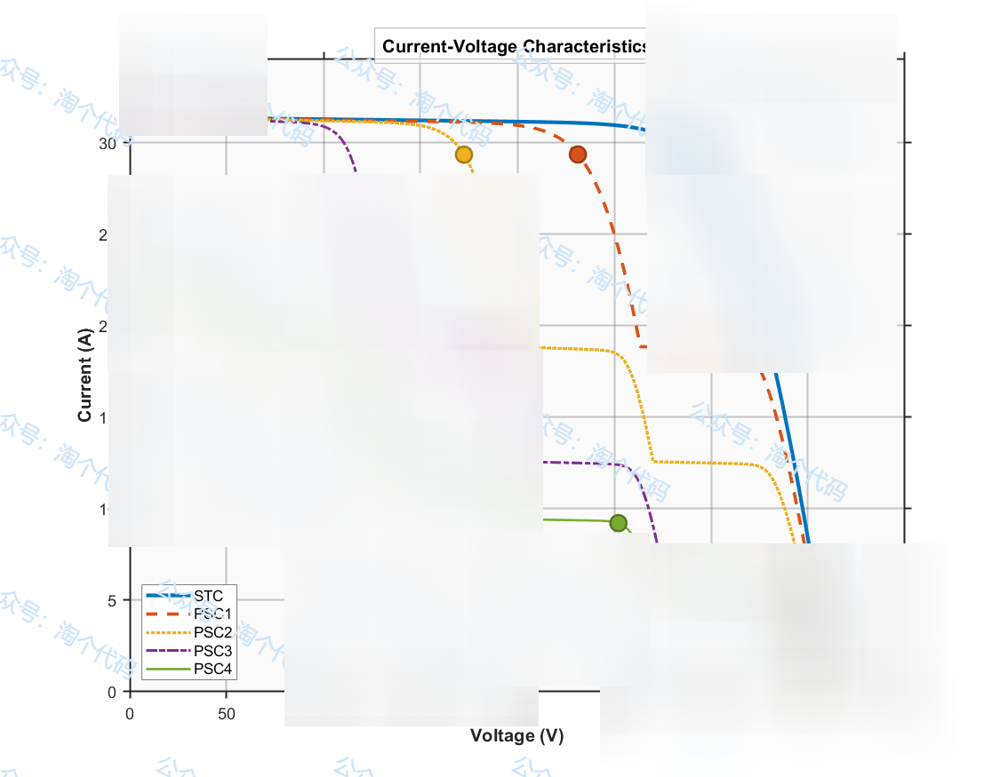
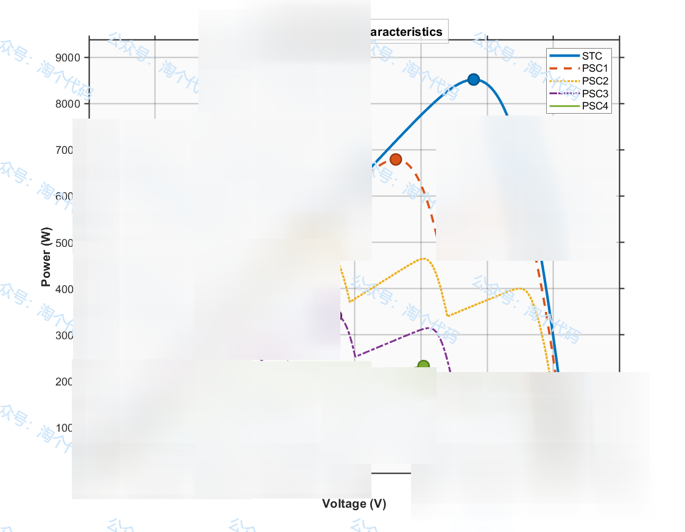
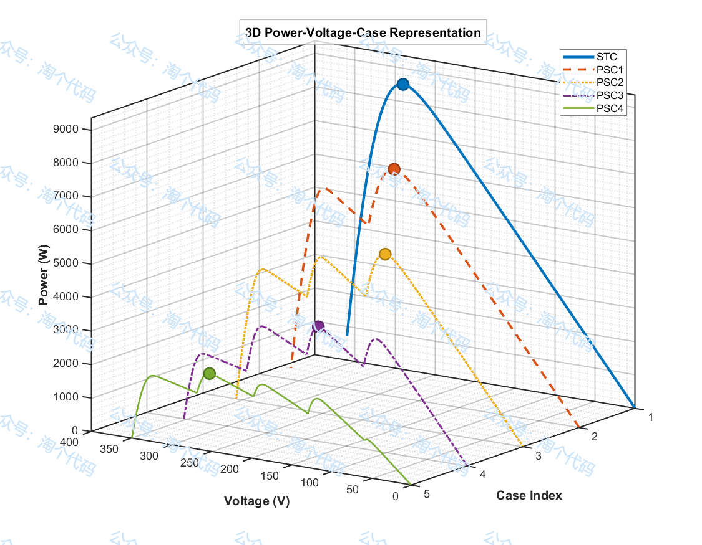
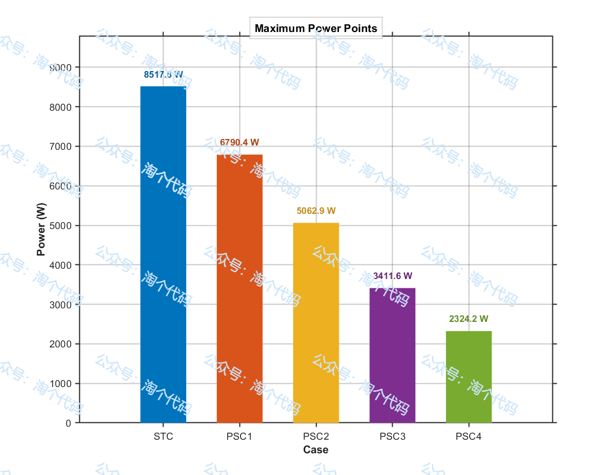
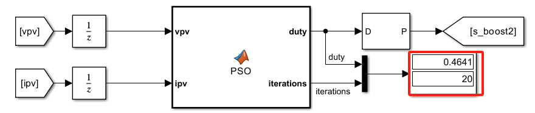
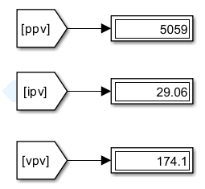
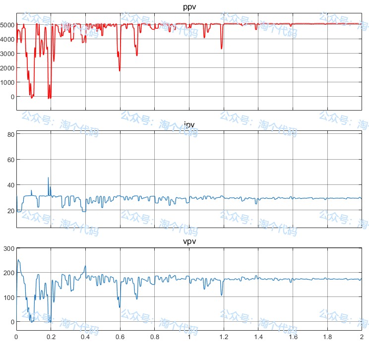
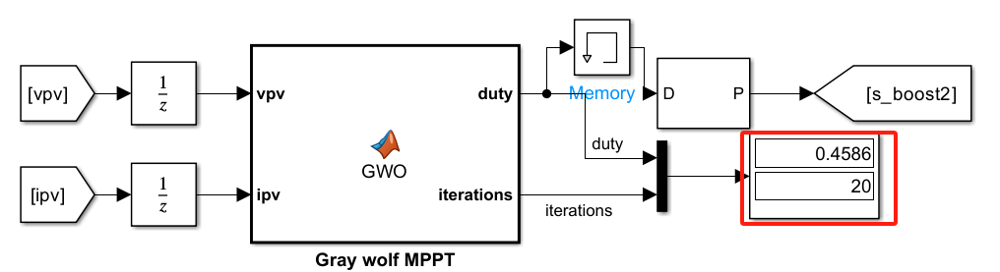
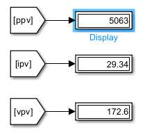
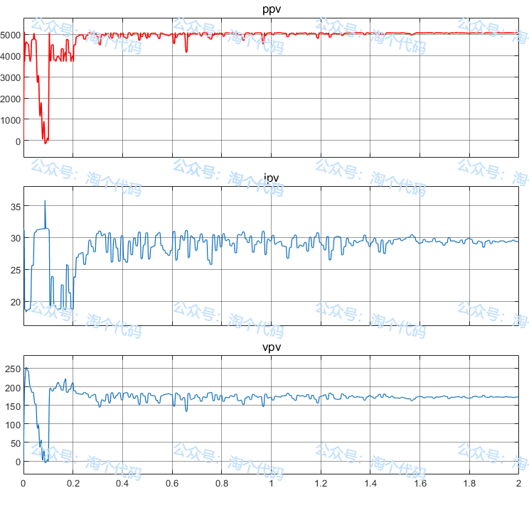

# PSOvsGWO Algorithm Optimization of MPPT (Partial Shading)

PSOvsGWO algorithm optimization MPPT in photovoltaic power systems, the maximum power point tracking (MPPT) is a core technology to improve energy conversion efficiency. However, traditional algorithms (such as perturbation observation method, conductance increment method) are prone to local optimality, response lag or power oscillation under complex working conditions.
This issue employs the classical particle swarm optimization and grey wolf algorithm to optimize MPPT, achieving maximum power point tracking of photovoltaic array under partial shading. By controlling the duty cycle parameter, it fully utilizes solar cells, thereby enhancing the photoelectric conversion efficiency.
1. Partial shading under photovoltaic array curve simulation
Each case includes 5 photovoltaic panels, with the light intensity of each panel altered. GMPP represents the maximum power point theoretical value for each case.
I-V Curves of Photovoltaic Arrays under Different Shading Modes:  P-V Curves under Different Shading Modes (here two modes are prepared for drawing)
2D drawing
3D Drawing - Theoretical Peak Power Point Value under Different Shadow Modes:
2. Particle Swarm Optimization (PSO) for MPPT
Here, a random case is selected, specifically Case 3 for experimentation. The photovoltaic panels' light intensities are set to [1000, 1000, 1000, 400, 600]. The duty cycle parameter of the PSO-optimized MPPT is determined using these data. The final optimization result is: the optimal duty cycle parameter is 0.4641. After optimization, the maximum power output of the photovoltaic system is achieved at 5059 W, with corresponding current and voltage values being 29.34 A and 172.6 V respectively. The simulation curve of the PSO-optimized MPPT shows that the optimized results of 5059 are very close to the theoretical value of 5062.
3. Grey Wolf Optimization (GWO) for MPPT
Similarly, Case 3 is chosen for experimentation. The photovoltaic panels' light intensities are set to [1000, 1000, 1000, 400, 600]. The duty cycle parameter of the GWO-optimized MPPT is determined using these data. The final optimization result is: the optimal duty cycle parameter is 0.4586. The maximum power output of the photovoltaic system is achieved at 5063 W, with corresponding current and voltage values being 29.34 A and 172.6 V respectively. The simulation curve of the GWO-optimized MPPT shows that the optimized results of 5062 are essentially the same as the theoretical value.
From the above observations, it can be seen that both GWO and PSO have excellent performance!

## Images

<!-- PAYMENT_BLOCK -->

## Get this dataset

- Payment link (Stripe): [Buy now](https://buy.stripe.com/3cs8yP7sY87d0vu9AB)
- Payment QR code: 

<!-- /PAYMENT_BLOCK -->
